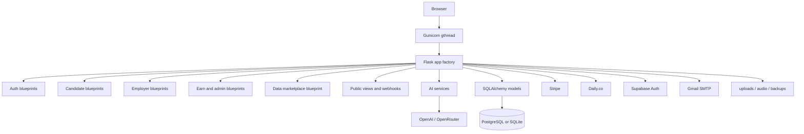
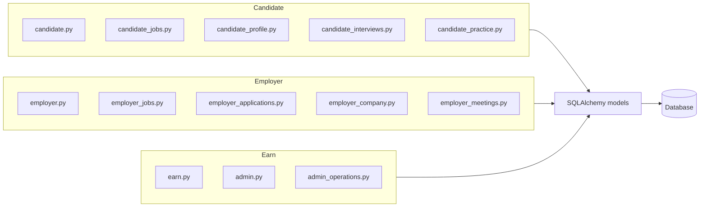
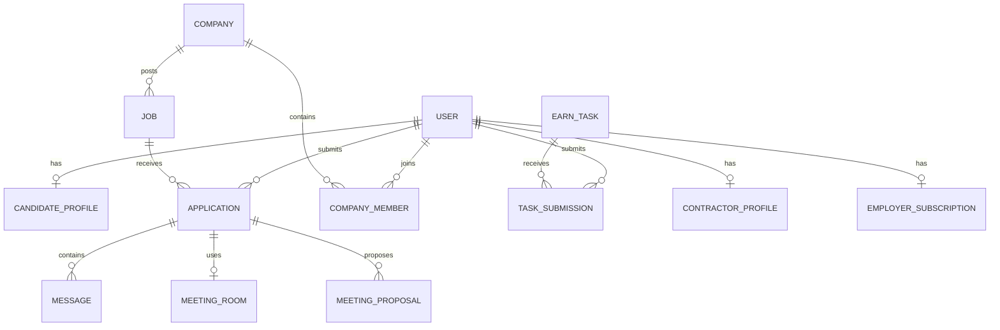
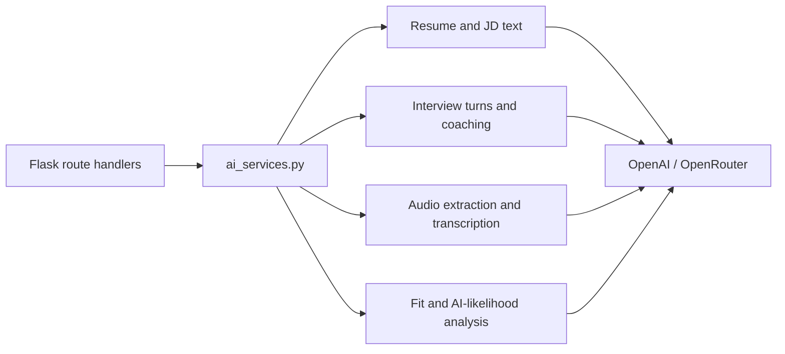
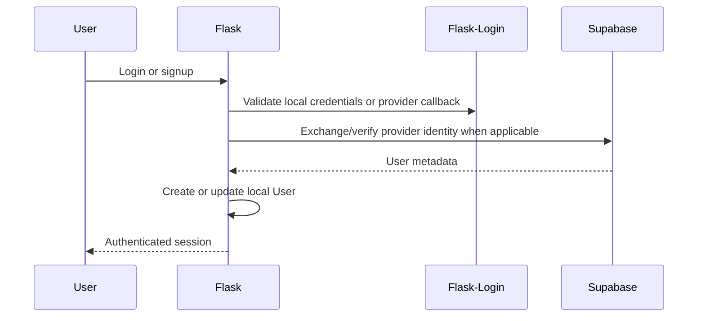
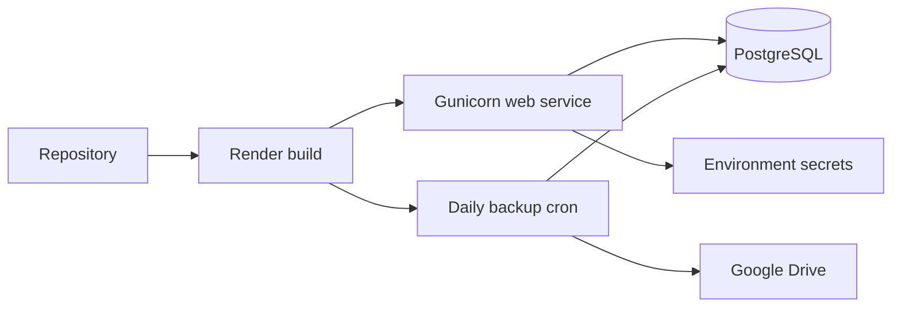

# Avants AI Project Architecture

## 1. Runtime Overview

Avants AI is a monolithic Flask application with server-rendered Jinja2 templates. The app uses Flask-SQLAlchemy for persistence, Flask-Login for sessions, Flask-Mail for transactional email, Flask-Limiter for route limits, and one shared app factory.

## 2. Entry Points

### `app.py`

- Loads environment configuration.
- Creates the app with `create_app()`.
- Hosts standalone resume tools and top-level routes.
- Handles resume matching, resume summarization, PDF export, TTS, practice and video-scan flows.
- Keeps short-lived in-memory caches for Post/Redirect/Get and scan/video jobs.

### `website/__init__.py`

- Defines the app factory.
- Initializes SQLAlchemy, Mail, Limiter, LoginManager, folders, migrations, and blueprints.
- Creates tables and runs startup additive migrations.
- Adds referral, unread-message, JSON, and time/salary template globals.

## 3. Blueprint Map

| Area | Modules | Responsibility |
|---|---|---|
| Public and webhooks | `website/views.py`, `website/auth.py` | Landing pages, public site, Stripe webhook, auth entry points |
| Employer | `employer.py` and split modules | Jobs, applicants, company, meetings, talent, analytics, billing |
| Candidate | `candidate.py` and split modules | Jobs, applications, profile, dashboard, interviews, practice |
| Earn | `earn.py`, `admin.py`, `admin_*` | Training tasks, submissions, consensus, contractor payouts |
| Data | `data_market.py`, `dataset_export.py` | Data-buyer access, subscriptions, exports |
| Shared | `website/models.py` | Users, companies, jobs, applications, meetings, billing, Earn and marketplace entities |

## 4. Data Architecture

The primary domain relationships are:

Important model groups include:

- `User`, `CandidateProfile`, `Company`, `CompanyMember`, `CompanyInvite`
- `Job`, `Application`, `SavedJob`, `DeletedJob`
- `MeetingRoom`, `MeetingProposal`, `Message`
- `EmployerSubscription`
- `EarnTask`, `TaskSubmission`, `ContractorProfile`
- `DataBuyer`, `Feedback`, `FeedbackInsight`

## 5. AI Architecture

All OpenAI/OpenRouter behavior is centralized in `ai_services.py` and split service modules.

No route handler should call the OpenAI client directly. Route handlers should translate provider and rate-limit exceptions into logged failures and safe responses.

## 6. External Services

| Service | Module / area | Purpose |
|---|---|---|
| OpenAI / OpenRouter | `ai_services.py`, `ai_service_*.py` | Resume, matching, interview, transcription, coaching |
| PostgreSQL / SQLite | SQLAlchemy and `_run_migrations()` | Application persistence |
| Supabase | `auth_login.py`, `auth_verification.py`, `supabase_client.py` | Google/provider auth and service operations |
| Stripe | billing and views modules | Hiring placement fees, plans, and data subscriptions |
| Daily.co | `daily_utils.py`, meeting modules | Meeting rooms and recordings |
| Gmail SMTP | `email_utils.py`, Flask-Mail | Transactional email |
| Google Cloud / TTS | `app.py`, Google credential configuration | Text-to-speech and vision/transcription support |
| Google Drive | `backup_database.py` | Daily database backup uploads |

## 7. Authentication Architecture

The local `User` table is primary for Flask-Login. `supabase_uid` links it to provider identity and service-role operations.

## 8. Payments Architecture

- Employer placement fees use Stripe Payment Links; the webhook marks an application fee paid.
- Employer subscriptions use `EmployerSubscription` and `PLAN_LIMITS`.
- Data-buyer subscriptions use separate price and webhook configuration.
- Recurring hourly-hire state is stored on `Application`.

## 9. Deployment Architecture

Production runs Python 3.12.11. Gunicorn uses one process with four gthread workers and a 300-second timeout. This is intentional because selected in-process caches and Flask-Limiter storage assume shared memory in the web process.

## 10. Schema Evolution

There is no migration framework. `_run_migrations()`:

1. Executes a list of additive `ALTER TABLE` statements.
2. Wraps each statement in an exception-safe block.
3. Runs backfills for company domains and referral codes.
4. Permits startup-safe re-execution.

SQLite and PostgreSQL syntax differences must be considered; startup migrations are not a general cross-dialect migration system.

## 11. Storage and Safety Boundaries

- `uploads/` and `audio/` are local scratch storage and must be treated as ephemeral.
- `.env` must not override variables already set in the process.
- Production database writes outside tested app routes are prohibited.
- Destructive scripts require a verified throwaway database before import and execution.
