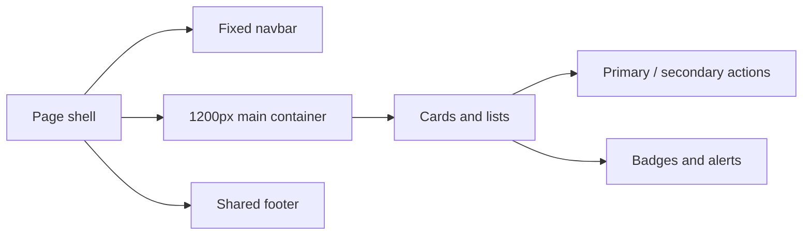
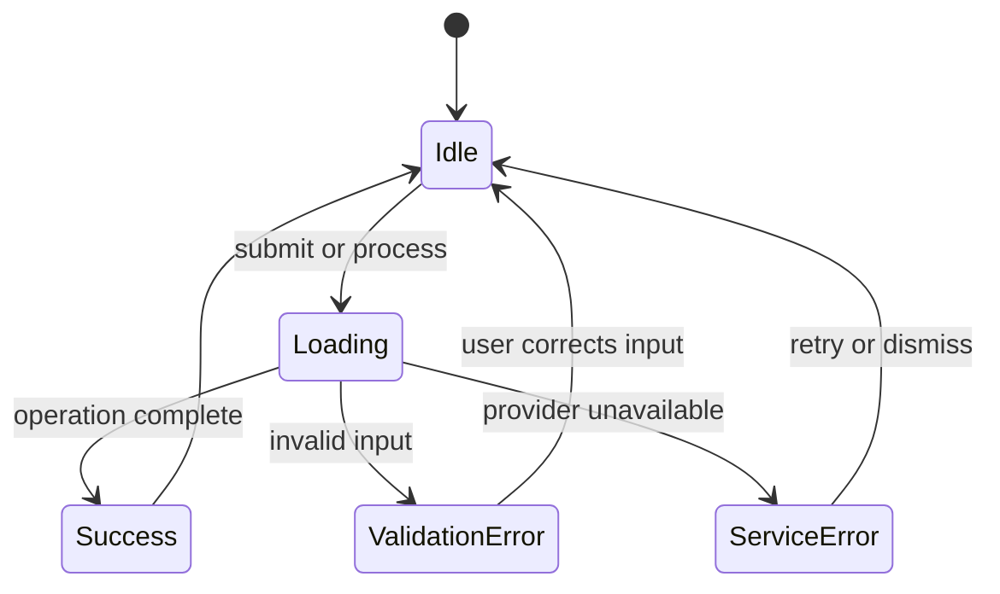

# Avants AI UI/UX Direction

## 1. Experience Principles

1. **Role clarity:** Candidate and employer navigation, dashboards, and actions must be visually distinct and easy to understand.
2. **Progress visibility:** Applications, interviews, meetings, payouts, and hiring steps should show clear status.
3. **Low-friction actions:** Primary actions use one obvious button; destructive actions use confirmation.
4. **Trust and evidence:** Scores and AI verdicts should explain the supporting information rather than appear as unexplained black-box values.
5. **Responsive simplicity:** Server-rendered pages must remain usable from desktop to mobile.
6. **Safe copy:** Errors should be recoverable and never expose provider, database, or credential details.

## 2. Visual Foundation

### Color Tokens

| Token | Value | Use |
|---|---|---|
| `--bg` | `#f4f5f7` | Page background |
| `--surface` | `#ffffff` | Cards, navbar, inputs |
| `--text` | `#111318` | Primary text |
| `--text-muted` | `#6b7280` | Secondary text and metadata |
| `--border` | `#e5e7eb` | Separators and card borders |
| `--primary` | `#4f46e5` | Primary actions and active states |
| `--primary-dark` | `#4338ca` | Hover |
| `--primary-soft` | `#eef2ff` | Selected or informational accents |
| `--success` | `#059669` | Successful state |
| `--warning` | `#b45309` | Caution |
| `--danger` | `#dc2626` | Errors and destructive state |

### Typography

- Font: Inter with system sans-serif fallback.
- H1/H2/H3 use tight negative letter spacing.
- Body text uses the Bootstrap-readable scale.
- Long AI-generated text should preserve paragraphs and be readable at a 1200px max width.

### Shape and Elevation

- Border radius: 10px for cards and major controls.
- Buttons: 8px, with rounded CTA options when a page uses pill actions.
- Small card shadow:
  `0 1px 3px rgba(0,0,0,0.06), 0 1px 2px rgba(0,0,0,0.04)`
- Hover states should add a subtle primary border or soft ring, not strong motion.

## 3. Shared Layout

- Fixed 64px navbar.
- Avants logo on the left.
- Role-aware navigation on the right.
- Candidate search and resume tools when appropriate.
- Employer dashboard, recruitment tools, and company navigation.
- Account dropdown for profile/settings/admin/logout.
- Unread message and notification indicators in the navbar.
- Shared Flask flash alerts above page content.
- Main container max width 1200px; wide pages may use 1440px.

## 4. Component Guidance

### Buttons

- Primary: one main action per section.
- Secondary: outline or neutral text button.
- Danger: reserve for withdrawal, account deletion, job deletion, and rejection.
- Buttons must include visible text or an accessible icon label.

### Cards

- Use cards for grouped jobs, applications, meeting details, profile sections, and marketplace tasks.
- Card headers use a white surface and bottom border.
- Lists should avoid excessive nested card depth.

### Forms

- Labels must remain visible; placeholders are supplemental.
- Separate first name and last name fields.
- Password fields should provide independent reveal controls and live confirmation status.
- Preserve selected values after validation errors.
- Show inline field errors and one alert for broad submission failure.

### Lists and Tables

- Job cards show title, company, location, employment type, and salary.
- Applicant rows show candidate identity, match score, application status, and primary action.
- Meeting items show participants, proposed/accepted time, and room state.
- Earn tasks show domain, reward, deadline or response requirements, and submission state.

### Status

- Use badges or compact labeled values.
- Green: accepted, paid, complete.
- Indigo: active, scheduled, in review.
- Amber: pending, needs evidence, awaiting candidate/employer action.
- Red: rejected, disputed, failed.

## 5. Key Page Directions

### Public/Landing

- Explain the three-way value: candidate, employer, and Earn.
- Make job search and employer signup obvious.
- Keep the visual hierarchy simple: hero, role paths, proof/value, and call to action.

### Candidate Dashboard

- Surface applications and next actions first.
- Show status and interview progress rather than dense full records.
- Link to practice, resume tools, and meetings.

### Job Search

- Search and category filters remain visible.
- Use compact job cards with clear company and location metadata.
- Avoid hiding salary or remote/work mode in repeated content.

### Application and Interview

- Explain each interview step.
- Show the camera requirement before joining.
- Keep transcript/audio and AI feedback clearly separated from employer notes.
- Resume-later state should always communicate where and how a session can be continued.

### Employer Dashboard

- Prioritize open jobs and new applications.
- Applicant ranking should include match score plus an explanation.
- Blind mode must avoid accidental exposure of identity.
- Use explicit labels for hire confirmation and fee state.

### Earn Marketplace

- Treat rewards and requirements prominently.
- Domain restrictions must be visible before task submission.
- Display consensus/progress only when relevant.
- Payout status should remain clear and separate from task approval.

### Public Candidate Profile

- Use the candidate's combined full name.
- Keep first-name initial for avatar treatment.
- Preserve privacy in blind-hiring contexts.

## 6. Responsive Behavior

- Navbar collapses into a mobile menu.
- Multi-column dashboards stack at medium widths.
- Job/applicant cards remain full-width and readable on narrow screens.
- Meeting controls and recording permissions must remain usable on mobile.
- Tables should convert to stacked rows or horizontal scrolling rather than clipping data.

## 7. Accessibility

- Maintain visible focus states and a minimum 4.5:1 text contrast for normal text.
- Do not communicate status through color alone.
- Use semantic headings and labels.
- Use ARIA only for controls that need it; prefer native HTML.
- Provide clear names for icon-only password/reveal/notification controls.
- Respect `prefers-reduced-motion` if motion is added later.

## 8. Visual State System

