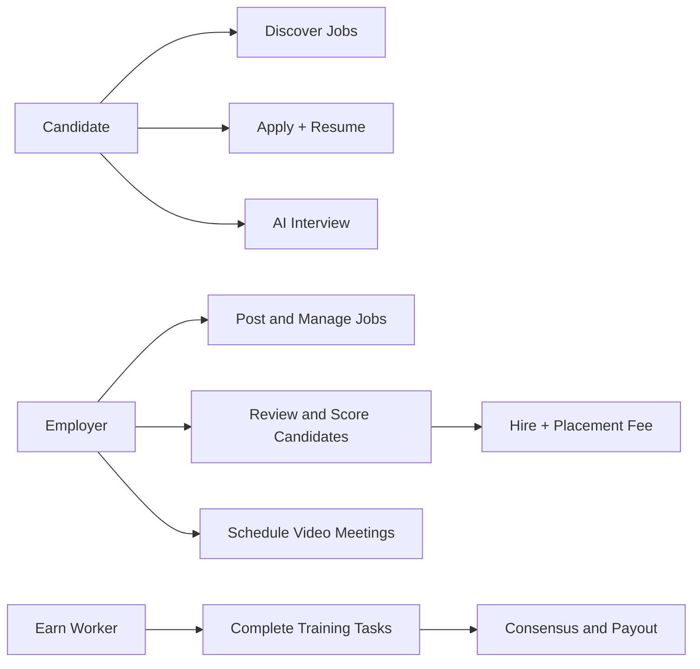

# Avants AI Product Requirements

## 1. Product Summary

Avants AI is a Flask recruiting marketplace that combines job discovery, resume analysis, AI-assisted interviews, employer review, live video meetings, hiring and placement billing, and an Earn marketplace for paid AI-training micro-tasks.

## 2. Users and Goals

| Persona | Primary goals | Key outcomes |
|---|---|---|
| Candidate | Find relevant jobs, improve a resume, apply, practice, and prepare for interviews | Applications, match scores, interview reports, skills roadmaps |
| Employer | Create jobs, compare applicants, interview candidates, hire safely | Ranked applicants, interview evidence, meeting schedules, hiring records |
| Contractor / Earn worker | Complete vetted paid tasks for AI training | Approved submissions, earnings, payout status |
| Admin | Operate the Earn marketplace and moderate company/workflow data | Task controls, submissions, consensus results, contractor payouts |
| Data buyer | Purchase approved dataset exports | Subscription access and downloadable exports |

## 3. Core Experiences

### 3.1 Candidate Experience

- Registration and login with local credentials or Supabase Google authentication.
- Separate first-name and last-name profile fields and a null-safe combined name.
- Candidate profile, resume, target roles, skills, experience, availability, location, and work preference.
- Job search and browse flow with categories and location filters.
- Resume upload and job matching.
- Resume summarization and basic resume analysis.
- Job application, saved applications, withdrawal, and status tracking.
- AI text or voice interview sessions, with saved resume-later support.
- Interview transcript, audio artifacts, verdict, AI-likelihood signal, and skills-gap roadmap.
- Practice interview hub and coaching.
- Notifications, messaging, meetings, referrals, account settings, and Earn access.

### 3.2 Employer Experience

- Work-email signup and company creation or joining by email domain.
- Company profile, logo, blind-hiring mode, platform terms, and team members.
- Job creation and editing with location, category, employment type, salary range, currency, and interview settings.
- Candidate search and applicant review.
- Automated resume-to-job match score and explanation.
- Candidate review, notes, feedback, rejection, saved candidates, and manual interview rating.
- AI-curated or employer-curated interview questions.
- Camera requirements for AI interviews.
- Meeting proposals with candidate acceptance and Daily.co meeting rooms.
- Candidate confirmation of hire, placement-fee records, evidence, disputes, and recurring billing.
- Subscription-plan views and Stripe billing webhooks.
- Talent pool and blind-hiring controls.

### 3.3 Earn and Data Marketplace

- Domain-gated Earn task discovery.
- Task submissions and agreement/consensus scoring.
- Minimum-response thresholds and consensus answers.
- Contractor profile and Stripe payout enablement.
- Admin task creation and contractor payout operations.
- Data-buyer accounts and separate Stripe subscription/export flow.

## 4. Functional Requirements

### Authentication and Accounts

1. Users must have an email, role, password or provider identity, and profile name fields.
2. Candidate and employer flows must remain isolated by role.
3. Email verification and password recovery must use signed or provider-supported flows.
4. Password and auth-provider failures must not disclose sensitive server details to the browser.
5. External account links and email links must use the public base URL, not the request host.

### Job and Application Data

1. Jobs must belong to a company and support open/closed status.
2. Applications must connect one candidate to one job.
3. Application records must preserve match, interview, feedback, withdrawal, meeting, and hire state.
4. Deleted jobs must retain a restorable snapshot.
5. Salary values must preserve currency, pay type, and optional salary ranges.

### AI Features

1. OpenAI calls must flow through `ai_services.py`.
2. Resume extraction must support PDF, DOCX, TXT, and configured audio/video inputs.
3. AI-cost-sensitive routes must be rate-limited.
4. AI failures must produce safe user-facing fallback messages and server-side logs.
5. Long-running interview or video processing must use appropriate timeout and thread settings.

### Payments

1. Placement fees and employer plans are separate Stripe flows.
2. Placement fee links must be created only through reviewed employer/candidate hiring routes.
3. Stripe webhook handling must verify and persist payment state.
4. Recurring hourly-hire billing must retain subscription state and engagement end state.
5. Data-marketplace subscriptions must be handled independently from hiring fees.

### Media and External Integrations

1. Video rooms must use Daily.co and be associated with an application.
2. Meeting proposals must be accepted before room creation.
3. Candidate/employer recordings must remain linked to the meeting room.
4. Uploaded files and generated audio must be treated as ephemeral unless persisted by the application.
5. Google/TTS, Supabase, Mail, Stripe, and Daily credentials must come from environment variables.

## 5. Non-Functional Requirements

- Server-rendered Jinja2 pages must remain usable without a frontend build.
- PostgreSQL is the production target; SQLite is permitted as a local fallback and isolated test database.
- Production deploy: Gunicorn with gthread and 4 threads, 300-second timeout.
- Schema evolution is additive and startup-safe.
- User-facing exceptions must be generic, while detailed exceptions belong in logs.
- Production data and production user records must not be mutated by ad hoc scripts.
- The system must preserve behavior for existing users with missing optional profile fields.
- Database backups must run daily and retain 30 days by default.

## 6. Acceptance Criteria

- A candidate can create an account, complete a profile, search jobs, apply, and inspect application/interview state.
- An employer can create a company/job, review applicants, schedule a meeting, and record a hire.
- Resume and interview analysis endpoints are reachable only through the application and return safe failures.
- Auth, Stripe, Daily.co, email, and AI integrations use configured environment variables and public URLs.
- New database columns do not break startup on an existing database.
- The data and UI remain consistent across candidate, employer, admin, Earn, and data-buyer contexts.

## 7. Explicitly Out of Scope

- A separate SPA build or JavaScript frontend framework.
- Alembic or a new migration framework.
- Direct ad hoc writes to production data.
- Replacing live integrations with mock services in production.
- Guaranteed enforcement of every employer plan limit until route enforcement is completed.
