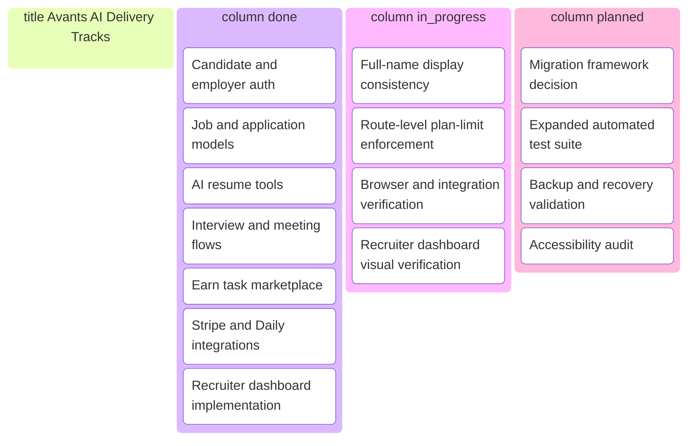

# Avants AI Tasks and Progress

## Current Status

The repository is a working Flask application with candidate, employer, interview, Earn, admin, billing, meeting, and data marketplace surfaces. Documentation, auth-name support, referral programs, currencies, blind hiring, recurring hire billing, and local-camera recordings are already present.



## Completed

- [x] Create and configure the Flask app factory and blueprints.
- [x] Implement local and Supabase/provider authentication.
- [x] Add candidate and employer roles.
- [x] Add first-name and last-name fields to `User` and candidate-facing flows.
- [x] Add a null-safe `User.full_name` property.
- [x] Update signup/profile name handling and public candidate-name displays.
- [x] Create company, job, application, candidate profile, and saved-job models.
- [x] Add additive startup schema migrations.
- [x] Add resume extraction, matching, summarization, and basic analysis.
- [x] Centralize AI calls in `ai_services.py`.
- [x] Add AI interview turns, transcript, verdict, coaching, and practice flows.
- [x] Add rate limiting for AI-cost-sensitive routes.
- [x] Add Daily.co meeting rooms and meeting proposals.
- [x] Add local camera recording fields and meeting recording handling.
- [x] Add employer notes, withdrawal, rejection feedback, and skills roadmaps.
- [x] Add blind hiring and camera-required job settings.
- [x] Add placement fee, employer subscription, and data subscription billing flows.
- [x] Add Stripe webhook handlers.
- [x] Add Earn tasks, submissions, consensus fields, contractor profile, and payouts.
- [x] Add data-buyer and export flows.
- [x] Add referral codes and referral landing-cookie behavior.
- [x] Add email verification and password recovery.
- [x] Add public base URL handling for transactional links.
- [x] Add daily database backup support and 30-day retention default.
- [x] Add server-rendered Jinja UI and shared CSS foundation.
- [x] Add recruiter dashboard overview, live hiring metrics, job actions, candidate matches, notifications, and AI assistant.

## In Progress

- [ ] Complete first-name/last-name consistency checks across every candidate/employer display.
- [ ] Verify plan limits before assuming `EmployerSubscription`/`PLAN_LIMITS` enforcement.
- [ ] Run browser interaction tests for signup, profile, apply, interview, meeting, and billing flows.
- [ ] Verify no route reads raw Jinja or provider configuration unsafely.
- [ ] Review startup migrations against both PostgreSQL and SQLite compatibility.

## Backlog

### Authentication and Accounts

- [ ] Add complete verification coverage for email/password and Supabase callback flows.
- [ ] Add account lockout or stronger login abuse controls if needed.
- [ ] Audit every role check and ownership check for IDOR risks.
- [ ] Verify account deletion and anonymization across all related entities.

### Candidate Experience

- [ ] Finish public-profile and notification name consistency.
- [ ] Add automated tests for profile save and OAuth metadata fallback.
- [ ] Improve resume upload validation and MIME/file safety.
- [ ] Test AI failure, timeout, and retry behavior.
- [ ] Audit saved-interview resume and expiration behavior.

### Employer Experience

- [ ] Enforce subscription limits in posting and applicant workflows.
- [ ] Test blind-hiring redaction in lists and exports.
- [ ] Complete the employer audit trail for hiring and placement fees.
- [ ] Verify salary/currency formatting across every page and email.
- [ ] Test company-domain joining and team invitation edge cases.

### Interviews and Meetings

- [ ] Test AI text and voice interview sessions end to end.
- [ ] Test candidate/employer camera capture and recording uploads.
- [ ] Verify room cleanup and expired-room behavior.
- [ ] Add timeout and partial-result recovery for long media processing.

### Payments

- [ ] Test Stripe placement-fee Payment Link and webhook state.
- [ ] Test employer plan upgrade, downgrade, and expiry behavior.
- [ ] Test recurring hourly-hire billing and engagement end.
- [ ] Test data subscription and dataset export gates.
- [ ] Add idempotency checks for payment webhooks.

### Earn and Data

- [ ] Test domain gating and consensus scoring.
- [ ] Test payout enablement and admin payout operations.
- [ ] Verify data-buyer access and export permissions.
- [ ] Add payout and task audit logs.

### Reliability and Operations

- [ ] Add a dedicated test database workflow.
- [ ] Add pytest or unittest fixtures for app factory and isolated PostgreSQL/SQLite databases.
- [ ] Add backup restore validation; current work only creates backup support.
- [ ] Pin and review production dependencies.
- [ ] Add health/readiness checks.
- [ ] Audit logs for secrets and sensitive payloads.
- [ ] Document rollback and incident response.

### UI/UX

- [ ] Run desktop and mobile visual checks, including the recruiter dashboard.
- [ ] Complete accessibility labels and keyboard checks.
- [ ] Standardize status badges and empty states.
- [ ] Test flash alerts and inline validation.
- [ ] Audit privacy/copy in blind-hiring and public-profile pages.

## Validation Checklist

### Safe Local Test Setup

```bash
set DATABASE_URL=sqlite:///D:/Avants_AI/Apricot/instance/test.db
python app.py
python -m unittest discover -s tests -v
```

Use an explicit throwaway database and verify the effective database URI after app import.

### Syntax Checks

```bash
python -m compileall -q app.py website ai_services.py ai_service_*.py
python -m unittest discover -s tests -v
```

No browser interaction test or full end-to-end suite is currently established.

## Progress Notes

- 2026-11-17: Added separate first/last-name persistence and display work.
- 2026-11-17: Removed an invalid `curses` import that crashed startup on Windows.
- 2026-11-17: Added server-side signup failure logging while keeping the browser message generic.
- 2026-11-19: Project-level requirements, architecture, coding, design, tasks, and memory documents created.
- 2026-11-22: Rebuilt the recruiter dashboard using live company-scoped hiring data; added responsive navigation, charts, activity, candidate matches, notifications, job controls, and a rate-limited AI assistant. Added an isolated SQLite integration test. Browser visual verification remains pending.
